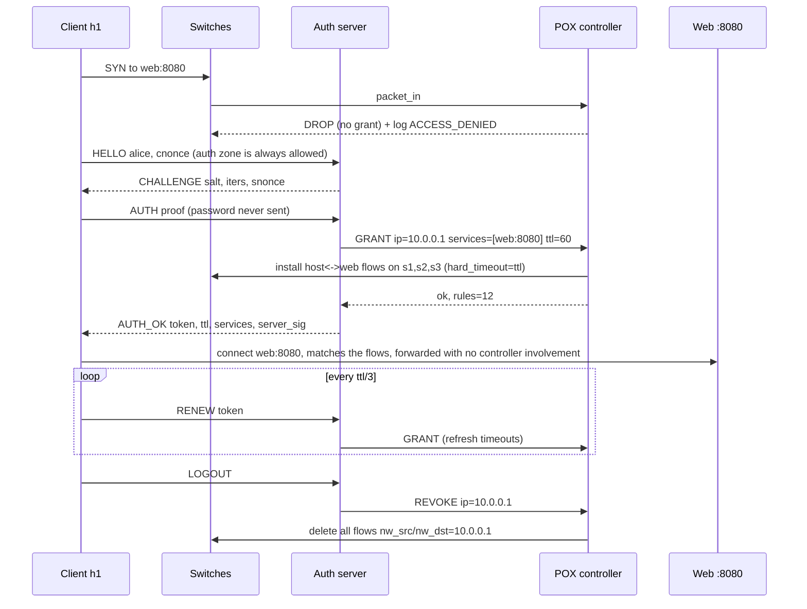
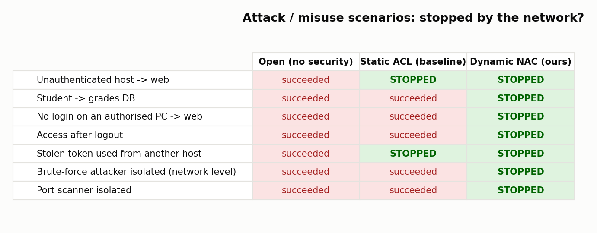
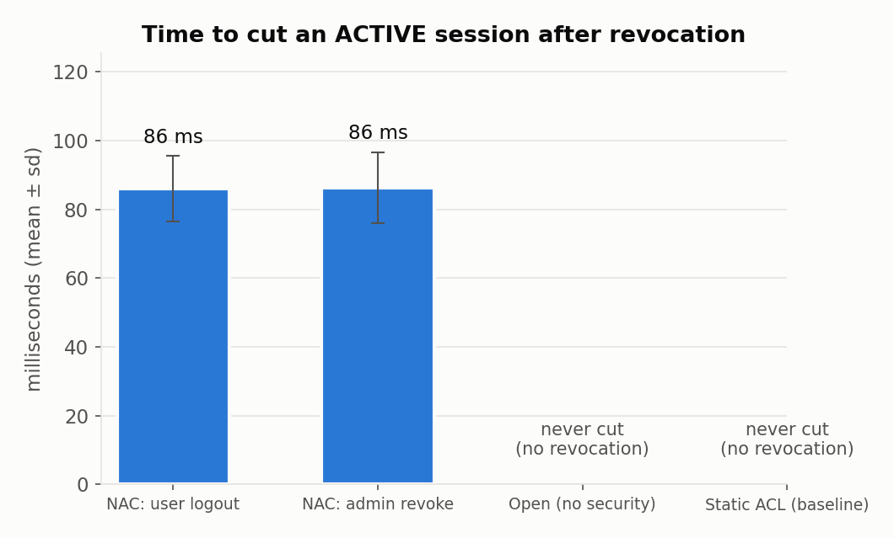
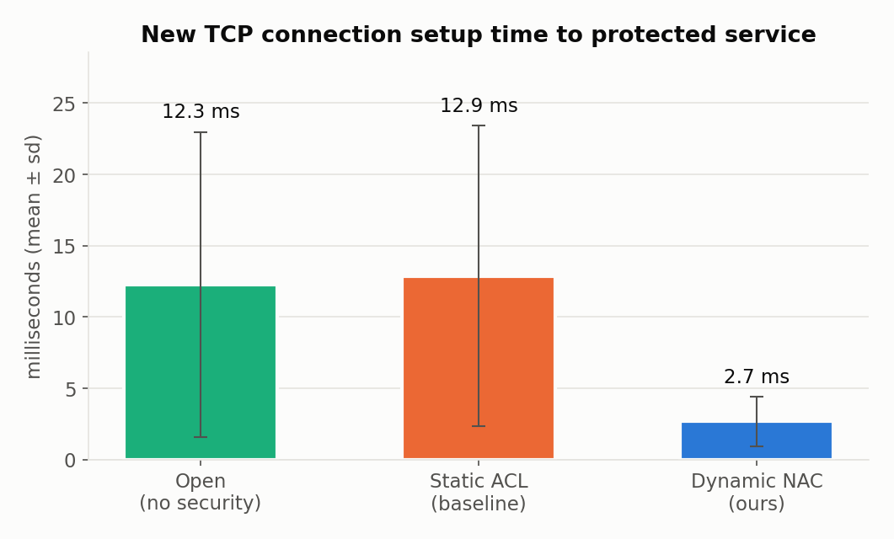
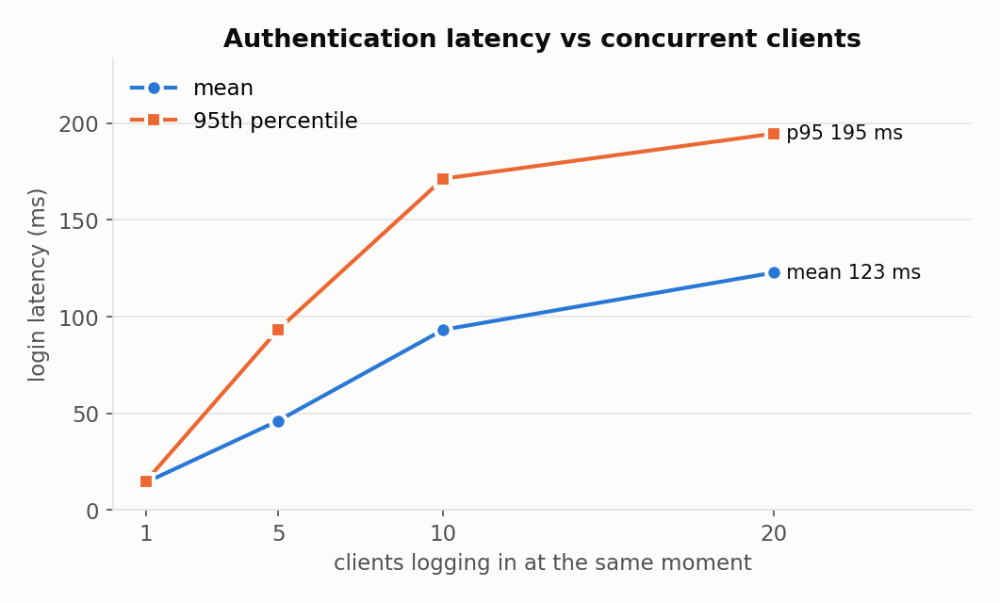
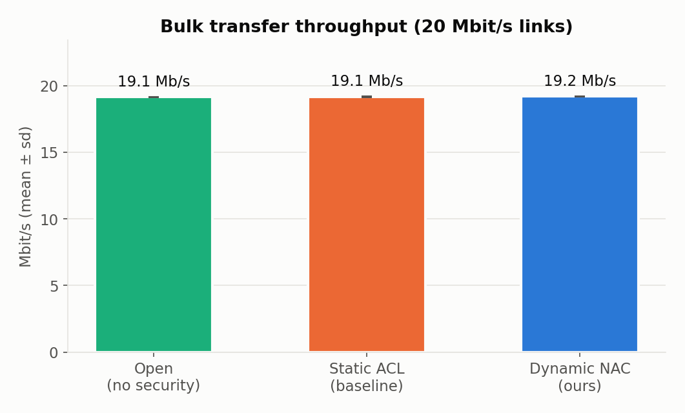
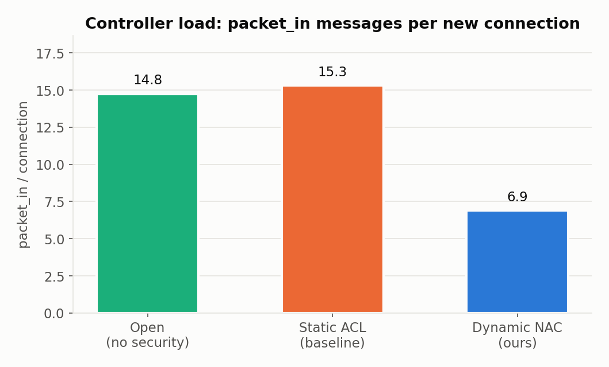

# Authentication and Network Access Control using TCP Sockets + SDN

**Jackfruit Mini Project – Computer Networks (SDN–Socket Programming), Topic 2**

Hosts must authenticate to a **TCP authentication server** before they can reach protected
network services. The **POX SDN controller** enforces this in the network itself:
by default it drops all traffic to protected services, and it **grants, restricts, or revokes**
access by installing and deleting OpenFlow rules when the auth server tells it to.

| | |
|---|---|
| Transport | TCP sockets (auth server, clients, protected services, auth↔controller control channel) |
| Network | Mininet, 3 Open vSwitch switches, OpenFlow 1.0 |
| Controller | POX (`controller/nac_controller.py`) |
| Language | Python 3 (standard library only, plus matplotlib for the graphs) |

---

## 1. Problem and objectives

On a normal LAN, any device that is plugged in can reach every server. We want:

1. **Authentication**: a host proves who its user is (username and password) over TCP.
2. **Authorization**: each role reaches only its services (student → web; faculty/admin → web + DB).
3. **Network enforcement**: unauthenticated packets never reach a protected server. The switches drop them.
4. **Sessions**: access lasts for a TTL, is renewed by keep-alives, and is **revoked** on logout, timeout or by an admin.
5. **Attack response**: brute-force guessing and port scans cause the attacker's host to be **blocked** at the network level.
6. **Logging**: every authentication and access decision is logged (`logs/auth.log`, `logs/controller.log`).

## 2. Architecture

```mermaid
flowchart LR
  subgraph Clients["Client side (s1)"]
    h1[h1 10.0.0.1]:::c
    h2[h2 10.0.0.2]:::c
    h3[h3 10.0.0.3]:::c
    eve[eve 10.0.0.66<br/>attacker]:::a
  end
  s1((s1 edge)) --- s2((s2 core)) --- s3((s3 server))
  h1 & h2 & h3 & eve --- s1
  s3 --- auth[auth 10.0.0.100<br/>TCP 5000<br/>Auth server]:::s
  s3 --- web[web 10.0.0.201<br/>TCP 8080]:::p
  s3 --- db[db 10.0.0.202<br/>TCP 9090]:::p
  POX[[POX NAC controller<br/>OpenFlow :6633<br/>control channel :6699]]:::k
  POX -. OpenFlow 1.0 .- s1 & s2 & s3
  auth <== "TCP control channel<br/>GRANT / REVOKE / BLOCK / events" ==> POX
  classDef c fill:#dbeafe; classDef a fill:#fee2e2; classDef s fill:#fef3c7; classDef p fill:#dcfce7; classDef k fill:#ede9fe
```

| Component | File | Role |
|---|---|---|
| Auth server | `app/auth_server.py` | Multi-threaded TCP server: challenge-response login, sessions and TTL, role policy, brute-force detection, admin commands, logs |
| Client | `app/client.py` | `login / status / renew / logout / access / bench / admin` and attack demos (`bruteforce`, `scan`) |
| Protected services | `app/service_server.py` | Multi-threaded TCP services (web portal :8080, grades DB :9090). They contain **no auth code**; the network protects them |
| SDN controller | `controller/nac_controller.py` | Default-deny policy, dynamic flow install/delete, blocking, port-scan detection, flow-stats monitoring, control channel |
| Topology | `topology/lab.py`, `topology/nac_topo.py` | Builds the Mininet network, starts every component, interactive CLI |
| Tests | `tests/run_tests.py` | 29 automated functional, security and monitoring tests |
| Evaluation | `perf/run_experiments.py`, `perf/plot_results.py` | Experiments against baselines, graphs |

The `auth` host sits in Mininet's **root namespace**. That way it is a normal host on the data plane for clients and can still reach the controller's control channel at `127.0.0.1:6699`.

### Communication flow



## 3. Protocols

### Client ↔ auth server (TCP 5000, one JSON object per line)

| Message | Purpose |
|---|---|
| `HELLO {user, cnonce}` → `CHALLENGE {salt, iters, snonce}` | Start login. Unknown users get a fake but stable salt, so usernames cannot be enumerated |
| `AUTH {proof}` → `AUTH_OK {token, ttl, role, services, server_sig}` / `AUTH_FAIL {reason, attempts_left}` / `BLOCKED {seconds}` | SCRAM-SHA-256-style proof. The server signature gives **mutual authentication** |
| `RENEW {token}` → `RENEW_OK {ttl}` | Keep-alive that extends the session |
| `LOGOUT {token}` → `BYE` | Ends the session and revokes access immediately |
| `STATUS {token}` → `STATUS {...}` | Session info |
| `ADMIN {token, action: LIST/REVOKE/BLOCK/UNBLOCK/STATS}` | Admin role only |

Login security: the password **never crosses the network**. Each login uses fresh client and server nonces, so a captured login cannot be replayed. `users.json` stores only `StoredKey/ServerKey`, so stealing that file does not let anyone log in. Tokens only work from the IP that logged in.

### Auth server ↔ controller (TCP 127.0.0.1:6699)

`HELLO {key}` (pre-shared key), then `GRANT {ip, user, services, ttl}`, `REVOKE {ip}`,
`BLOCK {ip, seconds, reason}`, `UNBLOCK {ip}`, `STATS`. Replies are matched by `id`.
Traffic also flows **from the network to the app**: the controller pushes events such as
`{"event":"HOST_BLOCKED","ip":..,"reason":"port-scan"}` and the auth server ends that host's session.

## 4. SDN policy (flow rules)

| Priority | Match | Action | Installed when |
|---|---|---|---|
| 1000 | `ip, nw_src=<blocked host>` | drop (hard timeout = block time) | BLOCK (brute force, port scan, admin) |
| 200 | `tcp host→svc tp_dst=port`, `tcp svc→host tp_src=port`, ICMP both ways | output to learned port, `hard_timeout = session TTL` | **GRANT** (proactive, on every switch) |
| 100 | exact match of the packet | output port | packet_in that passes the policy (auth zone, or granted traffic not yet located) |
| 50 | exact match of the packet | drop, 2 s hard timeout | packet_in that fails the policy (logged as `ACCESS_DENIED`) |
| 1 | `ipv6` | drop | switch connect |

Policy order at packet_in: blocked → **deny**; to/from auth server on TCP 5000 or ICMP → **allow** (pre-auth zone);
host has an unexpired grant for (service IP, port) → **allow**; otherwise → **deny**.
**REVOKE** deletes every flow with `nw_src=host` or `nw_dst=host` on all switches.
The controller also expires grants by itself, so the system **fails closed** if the auth server crashes.
Flow statistics are polled every 5 s to report per-host byte counts (`admin stats`).

Controller modes for comparison: `nac` (ours), `static` (fixed IP allow-list from `policy.json`, no authentication or revocation), `open` (learning switch, no security).

## 5. Setup

Tested on Ubuntu with Mininet 2.3 + Open vSwitch + POX (`gar` branch), Python 3.8–3.13.

```bash
git clone <this repo> sdn-nac && cd sdn-nac
./scripts/setup.sh          # installs mininet/ovs, clones POX to ~/pox, creates users.json
```

POX prints *"POX requires Python 3.6–3.9"* on newer Python. That warning is harmless; it works.

## 6. Running

**Interactive demo (two terminals):**
```bash
./scripts/run_controller.sh                 # terminal 1: POX, decisions appear live
sudo python3 topology/nac_topo.py           # terminal 2: Mininet CLI
```
```
mininet> h1 nac access 10.0.0.201 8080      # DENIED, not logged in
mininet> h1 nac login alice alice123        # GRANT, flows installed
mininet> h1 nac access 10.0.0.201 8080      # GRANTED
mininet> h1 nac access 10.0.0.202 9090      # DENIED, students can't reach the DB
mininet> sh ovs-ofctl dump-flows s1         # see the rules
mininet> h1 nac logout                      # REVOKE, flows deleted
mininet> eve nac bruteforce bob             # attacker BLOCKED after 5 failures
mininet> h3 nac scan 10.0.0.201 --ports 8070-8090   # port scan, auto-BLOCK
```
Accounts: `alice/alice123`, `carol/carol123` (student), `bob/bob123` (faculty), `admin/admin123`, `user01..user30 / pass01..pass30`.
Change policy in `config/policy.json`. Add a user with `python3 tools/make_users.py NAME PASS ROLE`.

**Automated tests** (about 2 min): `sudo python3 tests/run_tests.py` writes `results/test_report.md`.

**Performance evaluation** (about 8 min, `--quick` about 4 min):
```bash
sudo python3 perf/run_experiments.py        # runs open, static and nac modes
python3 perf/plot_results.py                # graphs + results/perf_summary.md
```
The *"sch_htb: quantum … is big"* lines during the experiment are harmless tc warnings.

## 7. Test cases (all 29 pass)

| Group | What is verified |
|---|---|
| Pre-auth | auth server reachable; protected services unreachable (TCP and ICMP) |
| Authentication | wrong password, unknown user (same generic error), valid login |
| Authorization | student → web only; faculty → web + DB; other hosts stay isolated; stolen token replay rejected |
| Concurrency | 3 users log in simultaneously and all get access |
| Revocation | logout cuts access; session timeout cuts access; keep-alive extends past the TTL; admin revoke |
| Admin | non-admin cannot run admin commands |
| Attacks | brute force → host blocked at network level, cannot log in even with the right password; port scan → controller auto-blocks and notifies auth server; malformed input → error, server survives |
| Monitoring | controller flow statistics report per-host bytes |
| Robustness | blocks expire automatically; **auth server crash → grants still expire at the controller (fail-closed)** |

Full table: [`results/test_report.md`](results/test_report.md).

## 8. Results

See [`results/perf_summary.md`](results/perf_summary.md). Numbers below come from a 20-client topology with 20 Mbit/s links.

| Metric | Open | Static ACL | **Dynamic NAC** |
|---|---|---|---|
| Attack/misuse scenarios stopped (of 7) | 0 | 2 | **7** |
| Active session cut after logout / admin revoke | never | never | **≈86–86 ms** |
| New-connection setup time | ≈12 ms | ≈13 ms | **≈3 ms** |
| packet_in per new connection | ≈15 | ≈15 | **≈6.9** |
| Throughput (20 Mbit/s link) | 19.1 | 19.1 | 19.2 Mbit/s |
| Login latency, 1 → 20 simultaneous clients | – | – | 14 → 123 ms (mean), 0 failures |
| Brute force → attacker blocked | not possible | not possible | 168 ms after attack start |








**Interpretation.**
- Dynamic NAC is the only mode that ties access to *identity and time*. Static ACLs trust the machine, not the user, and cannot revoke.
- Access control costs **nothing on the data plane**: throughput is identical in all three modes.
- Proactive flows installed at GRANT time make new connections **faster** than the reactive baselines, because packets skip the controller.
- Login latency grows with simultaneous logins (about 14 ms for 1 client, about 123 ms for 20). Login throughput reaches about 51 logins/s. The bottleneck is CPU-bound PBKDF2 on the clients plus the Python GIL in a single-VM emulation.

## 9. Limitations and future work

- No TLS: the session token is visible on the wire. It is bound to the client IP, but a host spoofing that IP could reuse it. Next step: TLS (`ssl` module) or 802.1X-style port binding (MAC + switch port).
- A single controller and a single auth server are single points of failure. The controller already fails closed; replication would remove them.
- Tree topology. Multi-path topologies would need `openflow.discovery` and spanning tree.

## 10. Repository layout

```
app/          auth_server.py  client.py  service_server.py  common.py
controller/   nac_controller.py            (POX component)
topology/     lab.py  nac_topo.py
tests/        run_tests.py
perf/         run_experiments.py  probe.py  plot_results.py
config/       policy.json  users.json
tools/        make_users.py
scripts/      setup.sh  run_controller.sh
docs/         DELIVERABLES.md  DEMO_SCRIPT.md  VIVA_QA.md
results/      test_report.md  perf_results.json  perf_summary.md  *.png
logs/         auth.log  controller.log  (generated)
```
